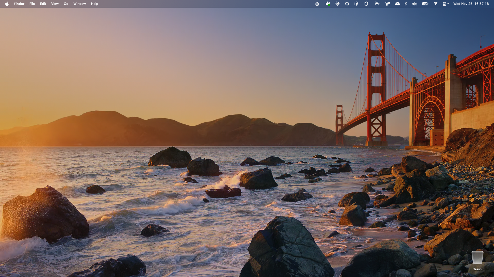
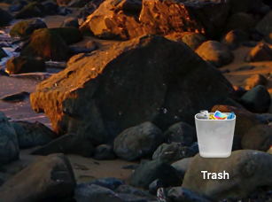
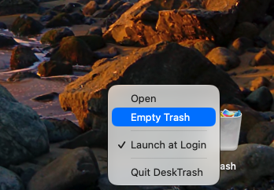

# DeskTrash

**The Trash, back on the desktop.**

Before Mac OS X, the Trash lived in the corner of your desktop. DeskTrash puts it back: a small native Swift app that is useless, and therefore essential.

**[Website](https://gasova.github.io/DeskTrash/)** · **[Download](https://github.com/gasova/DeskTrash/releases/latest)**



## Features

| Empty and full | Right-click menu |
| --- | --- |
|  |  |

- **Drop to trash**: drag files or folders onto the icon. Finder does the work, so Put Back and external drives behave as usual. See it in motion on the [website](https://gasova.github.io/DeskTrash/#features).
- **Empty and full**: the icon is the system Trash icon, and it fills up and empties on its own as the Trash changes.
- **Right-click menu**: open the Trash, empty it, or start DeskTrash at login.
- **Movable**: drag the icon anywhere and it stays there. It sits above the desktop icons and below every window, on all Spaces.

## Install

Requires macOS 13 or later, Apple Silicon or Intel.

1. Download the [latest release](https://github.com/gasova/DeskTrash/releases/latest) and open it.
2. Drag **DeskTrash** to the **Applications** folder.
3. Open DeskTrash. The Trash appears in the bottom right corner of the desktop.
4. When macOS asks whether DeskTrash may control Finder, choose **Allow**.
5. Right-click the icon and choose **Launch at Login** to keep it around.

## Build from source

Requires the Xcode command line tools (`xcode-select --install`). There is no Xcode project.

```
git clone https://github.com/gasova/DeskTrash.git
cd DeskTrash
bash build.sh
open DeskTrash.app
```

`build.sh` compiles `main.swift` into a universal `DeskTrash.app` and signs it ad hoc. `release.sh` signs it with a Developer ID, packages it as a DMG and notarizes it; setup instructions are at the top of that script.

## Notes

- The Trash in the Dock stays where it is; macOS does not allow removing it. Turn on Dock auto-hide if you want it out of sight.
- DeskTrash has no Dock icon or menu bar item. Quit it from the right-click menu.
- The Trash state is checked every 5 seconds, so the icon can lag slightly behind changes made elsewhere.
- You can change the Finder permission later in System Settings > Privacy & Security > Automation.
- The app is not sandboxed, so it cannot be distributed through the Mac App Store.

DeskTrash is an independent project and is not affiliated with Apple. Mac, macOS and Finder are trademarks of Apple Inc.
